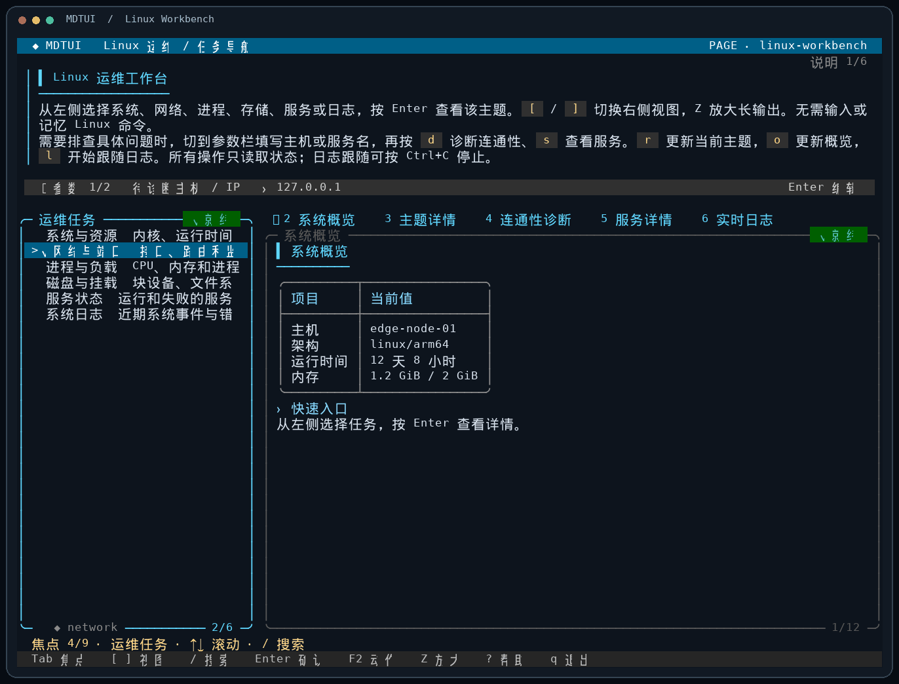

# MDTUI

**把已有 Linux 命令，编排成可以通过 SSH 使用的交互式 Markdown 工作台。**

MDTUI turns command-line diagnostics into a navigable terminal workspace. 选择对象、查看关联结果、刷新状态和跟随日志，都在一份 Markdown 页面中完成。



> 演示画面由 MDTUI 的终端渲染器和固定示例数据生成，不包含真实设备信息。[查看静态截图](docs/assets/linux-workbench.png)。

## 为什么用 MDTUI

设备上已经有 `ip`、`ss`、`ps`、`df` 等命令，却常常需要记住参数、复制对象 ID，再拼凑多条输出。MDTUI 把这些步骤编排到一个页面里，让操作者按任务浏览，而不是背命令。它适合嵌入式设备调试、远程 Linux 运维，以及为现有命令制作轻量内部工具。

| 能力 | 使用时的体验 |
| --- | --- |
| 交互式 Markdown 页面 | 标题、列表、引用、代码块和 GFM 表格在终端中清晰呈现 |
| 列表与参数联动 | 选中对象后，详情面板自动获取它的稳定 ID 并更新 |
| 多种布局 | 工作区、主从分栏和堆叠布局；窄终端自动调整 |
| 实时状态 | 定时刷新、一次性动作、流式日志和暂停跟随 |
| 可控执行 | 页面先校验；命令以参数数组执行，不通过 shell 拼接；输出不会被当作页面代码执行 |
| 轻量部署 | Go 构建的 Linux 二进制；通过普通 SSH PTY 使用，目标机器无需 Go 或 Python |

## 立即体验

在 Linux 或 WSL 构建机上安装 **Go 1.24+**，然后在项目根目录运行：

```sh
bash scripts/build.sh
./bin/mdtui check examples/linux-workbench.md
./bin/mdtui examples/linux-workbench.md
```

这个示例是由 MDTUI 页面驱动的 Linux 运维工作台。左侧选择系统、网络、进程、存储、服务或日志任务，右侧查看结果；也能输入主机名或服务名，触发连通性诊断和服务状态查询。`linux-tools` 适配器在当前 Linux 环境调用固定命令，缺少工具或权限时会在结果中说明。

另有 [模拟网络调试页面](examples/network.md)，可在没有设备和网络权限的环境中练习对象选择、刷新与流式诊断；[输入参数示例](examples/input.md) 展示表单交互。

[页面跳转示例](examples/navigation.md) 演示按运维主题打开不同的全屏子页，并在子页读取父页选中的对象；每个主题页可以拥有自己的布局、输入、动作和流式面板。[巡检台示例](examples/inspection.md) 演示 `on_focus` 与 `on_select`：光标移到巡检主题时预览采集计划，按 Enter 确认后才执行完整详情。

通过 SSH 使用时，需要分配 PTY，例如 `ssh -t user@device`，再在设备上运行已部署的 `mdtui PAGE.md`。构建与文件摆放方式见[部署指南](docs/build.md)。

## 几个按键就能操作

| 按键 | 作用 |
| --- | --- |
| `↑` / `↓`、`Enter` | 移动列表光标、确认选择 |
| `Tab` / `Shift+Tab` | 切换说明、参数和面板焦点 |
| `[` / `]` | 切换工作区详情视图 |
| 大写 `Z`、`Esc` | 放大当前面板、退出放大 |
| `F2` | 打开页面动作菜单 |
| `/`、`n` / `N` | 搜索当前区域、跳转匹配 |
| `q` | 退出并恢复终端 |

完整操作、输入编辑、日志跟随和错误状态见[使用手册](docs/user.md)。

## 页面就是 Markdown

普通 Markdown 是说明文字，`:::mdtui` 块声明交互元素。下面的详情面板引用列表中选中的对象；MDTUI 会在选择改变时重新查询：

```md
# 网络调试

选择一个接口，按 Enter 查看详情。

:::mdtui page
version: 1
id: network
layout: master-detail
sidebar: interfaces
:::

:::mdtui panel
id: interfaces
title: 接口列表
format: items-json
exec: ["./adapter", "list"]
:::

:::mdtui panel
id: detail
title: 接口详情
exec: ["./adapter", "show", {ref: "interfaces.selected.id"}]
:::
```

列表命令返回带稳定 `id` 的 `items-json`，详情命令可返回 Markdown。页面还支持输入、动作、确认框、定时刷新和流式面板。完整语法与约束见[语法参考](docs/syntax.md)、[页面作者指南](docs/author.md)及[命令适配指南](docs/adapter.md)。

## 项目结构与验证

- `cmd/mdtui`：工作台入口；`internal/document` 编译页面，`internal/scheduler` 管理依赖和刷新，`internal/tui` 渲染交互界面。
- `cmd/linux-tools`：真实 Linux 只读诊断适配器；`cmd/net-debug`：确定性的模拟适配器。
- `examples`：可直接运行的页面；`tests/integration`：真实 PTY、CLI 与性能测试。

```sh
bash scripts/verify.sh
bash scripts/cross-build.sh
```

验证脚本执行模块校验、`go vet`、单元与竞态测试、页面校验以及真实 PTY 交互测试；结果生成在本地 `docs/evidence/`，该目录不会进入仓库。[验证范围与已知边界](docs/acceptance.md)说明了当前覆盖范围。

**状态说明：**项目已在 Ubuntu 22.04 / WSL2 参考环境完成自动化验证，并构建 ARM64、ARM、MIPSLE Linux 产物；这些产物尚未在真实嵌入式设备上验收。页面具有执行本机程序的能力，请只运行可信来源的页面。`check` 仅解析和校验，不执行页面命令。

欢迎通过 Issue 反馈终端兼容问题或设备适配需求；贡献流程见[CONTRIBUTING.md](CONTRIBUTING.md)。

## 许可证

MDTUI 使用 [MIT License](LICENSE)。第三方依赖的许可证及声明见 [THIRD_PARTY_NOTICES.md](THIRD_PARTY_NOTICES.md)。
